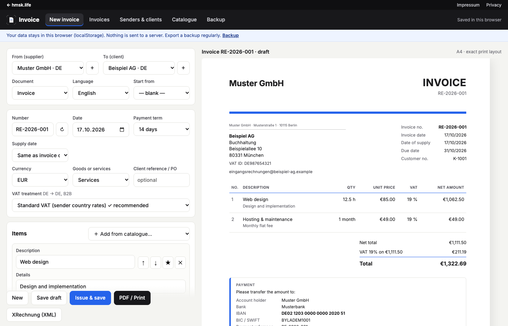

# Invoice

Free invoices for freelancers and small businesses in Germany and the EU, with the right VAT note picked automatically and XRechnung export.

**Use it online:** [hmsk.life/tools/invoice](https://hmsk.life/tools/invoice/) (runs in your browser, nothing is uploaded).



## Features

- **Senders and clients saved once** (address, VAT ID / tax number, register data, bank, logo, accent colour, number format). Any entry can be the sender or the client.
- **VAT treatment chosen automatically** from both countries and the client type: domestic VAT, small business (§ 19 UStG / Art. 53 CIVA), EU reverse charge, intra-EU supply of goods, export, supplier outside the EU, not VAT-registered. The matching legal note is printed in German, English or Portuguese (or bilingual).
- **Compliance check** lists what is missing under § 14 UStG, § 35a GmbHG, Art. 36 CIVA and the EU VAT Directive. Issuing is blocked while red items remain.
- **Documents:** invoice, pro-forma, quotation, credit note (refers to the original), self-billing (Gutschrift).
- **Numbering:** one series per sender (`RE-{YYYY}-{NNN}` etc.), optional per-client monthly series; issued numbers are never handed out twice. Issued documents are locked and keep a snapshot of both parties.
- **PDF:** browser print, exact A4 layout.
- **XRechnung export:** "XRechnung (XML)" creates an XRechnung 3.0 e-invoice in the UN/CEFACT CII syntax (EN 16931) for invoices, credit notes and self-billing invoices. See [XRechnung](#xrechnung) for what is covered and how it was validated.
- **Backup:** download everything as one JSON file and restore it.

## Two ways to run it

| | Browser mode (default) | Server mode (self-hosted) |
|---|---|---|
| Where data lives | `localStorage` of the browser you use | `data/db.json` on your server, outside the web root |
| Login | none | users with passwords (admin sees all invoices, users see their own) |
| Needs | any static web server, or open via a local server | PHP 8.1+ (or Docker) |
| Backup | download the JSON file regularly | last 50 versions kept automatically + JSON download |

The mode is picked in `public/config.js`:

- `storage: 'auto'` (default): server mode when `api.php` answers **and** at least one user exists, otherwise browser mode. So a fresh PHP install runs in browser mode until you create the first user.
- `storage: 'browser'`: never contacts `api.php` (static hosting).
- `storage: 'server'`: always login via `api.php`.

### Optional "Created with" footer line

`madeWith` in `public/config.js` adds one small line at the very bottom of every invoice (screen, print and PDF), in the invoice language, as a link: "Created with HMSK Invoice, free at hmsk.life" (DE: "Erstellt mit HMSK Invoice, kostenlos auf hmsk.life", PT: "Criado com HMSK Invoice, grátis em hmsk.life"). It sits in the bottom margin, so it never moves the invoice content, and it is never part of the XRechnung XML.

```js
madeWith: { enabled: false, url: 'https://hmsk.life/tools/invoice/' },
```

It is **off** in the default `config.js`, so a self-hosted copy carries no branding. The hosted copy on hmsk.life turns it on (`examples/hosted-config.js`, with a UTM-tagged URL). When it is on, every user can switch it off under *Backup > Footer line* or with the checkbox in the editor; the choice is saved with the other settings (in the browser, or per user on the server). Older data and backups without the setting count as "on".

In browser mode the app starts with fictional demo data (Muster GmbH, Jane Doe Design, …). Remove it under *Backup → Remove demo data* once your own sender is set up.

## Quick start

**Browser mode, no install (PHP or Python):**

```sh
php -S 127.0.0.1:8000 -t public          # or: python3 -m http.server 8000 --directory public
# open http://127.0.0.1:8000
```

**Server mode with PHP:**

```sh
printf %s 'a-long-password' | php tools/set-password.php data admin admin   # first user = admin
php -S 127.0.0.1:8000 -t public          # data in ./data (git-ignored)
```

Add more users the same way (`... data jane user`). On real hosting, put only `public/` in the web root and point the app to a data folder outside it with the `INVOICE_DATA_DIR` environment variable or a `public/config.php` containing `<?php $DATA = '/path/to/data';`.

**Server mode with Docker:**

```sh
cp .env.example .env                      # set INVOICE_ADMIN_PASSWORD (min. 10 characters)
docker compose up -d                      # http://localhost:8080
```

The image is `php:8.3-apache`; data lives in the `invoice-data` volume mounted at `/data`, outside the web root. The first admin user is created from `.env` on the first start. Without a password the container runs in browser mode. *Note: the Dockerfile and compose file have not been run yet (written without Docker available); please report problems.*

**Static copy (browser mode only)** for any web space or sub-path:

```sh
tools/build-static.sh dist                # optional 2nd argument: your own config.js (see examples/)
```

## XRechnung

- Syntax: UN/CEFACT Cross Industry Invoice D16B, specification identifier `urn:cen.eu:en16931:2017#compliant#urn:xeinkauf.de:kosit:xrechnung_3.0`, profile `urn:fdc:peppol.eu:2017:poacc:billing:01:1.0`.
- Contents: seller and buyer (name, address, VAT ID, tax number, electronic address), seller contact, lines with unit codes and line discounts, VAT breakdown per category (`S` standard, `Z` zero-rated, `E` § 19 small business with exemption reason, `AE` reverse charge, `K` intra-EU supply incl. deliver-to country, `G` export of goods, `O` not subject to VAT for services outside the EU / non-registered suppliers), totals, SEPA credit transfer with IBAN/BIC, payment terms and due date, service date or period, buyer order reference, original invoice for credit notes, register details as a `REG` note.
- **BuyerReference (BT-10):** the client's *Leitweg-ID / buyer reference* field; `n/a` when empty. Public-sector clients in Germany require their Leitweg-ID.
- The editor shows whether all data needed for XRechnung is present (sender email + phone + IBAN, client email, VAT IDs for reverse charge, …). Only EUR invoices are exported.
- **Validation:** `tools/validate-xrechnung.sh` generates ten reference cases from the demo data (domestic 19 % + 7 % with discount, zero-rated line, § 19 small business, EU reverse charge, intra-EU goods, export of services and goods, credit note, public-sector client with Leitweg-ID, self-billing) and checks them like the KoSIT validator scenario for XRechnung 3.0.2 (CII): XML Schema (xmllint) + CEN EN 16931 schematron 1.3.16 + XRechnung 3.0.2 schematron, including the scenario's severity overrides, using the official compiled rules from [validator-configuration-xrechnung](https://github.com/itplr-kosit/validator-configuration-xrechnung) (release 2026-08-31) run with SaxonJS. All ten pass with no errors and no warnings. All ten were also checked with the **official KoSIT validator 1.6.3** (Java, same configuration): *Acceptable: 10, Rejected: 0* (2026-10-17). To run it yourself (Java 17+):

```bash
gh release download v1.6.3 -R itplr-kosit/validator -p 'validator-1.6.3-standalone.jar' -D tools/.cache
java -jar tools/.cache/validator-1.6.3-standalone.jar -s tools/.cache/kosit/scenarios.xml -r tools/.cache/kosit test-out/xrechnung/*.xml
```

This is a validation, not a certification. Check your first real e-invoice with your recipient.
- Not included: ZUGFeRD / Factur-X (PDF with embedded XML), UBL syntax, sending via PEPPOL, attachments, document-level allowances/charges, invoices in other currencies.

## Legal note

This tool helps you create correct invoices; it is **not tax advice**. The rules cover the common cases; special cases (construction services § 13b UStG, OSS, margin schemes, small-business turnover limits) need a tax adviser. **Portugal:** legal *faturas* must be issued with AT-certified software (ATCUD, QR code, SAF-T). For Portuguese senders the tool flags invoices as not valid and is meant for pro-formas and quotations only.

## Development

```
public/            web root: index.html, app.js (UI + storage), rules.js (VAT logic + checks),
                   render.js (A4 layout), xrechnung.js (CII export), i18n.js, demo.js, config.js, api.php
tools/             set-password.php, render_test.js (sample PDFs), xrechnung_test.js + validate-xrechnung.sh,
                   e2e_browser.js (headless Chrome end-to-end test), build-static.sh
docker/            Apache config + entrypoint for the Docker image
```

```sh
node tools/render_test.js                               # sample invoices -> test-out/*.pdf (needs Chrome)
tools/validate-xrechnung.sh                             # XRechnung samples + validation (node, npm, xmllint)
node tools/e2e_browser.js http://127.0.0.1:8000/        # create -> issue -> print -> XML -> credit note -> backup (+ footer opt-out if enabled)
```

## License

MIT © 2026 Hafiz Muhammad Sharoz Khalid. Made for [hmsk.life](https://hmsk.life/tools/invoice/).
